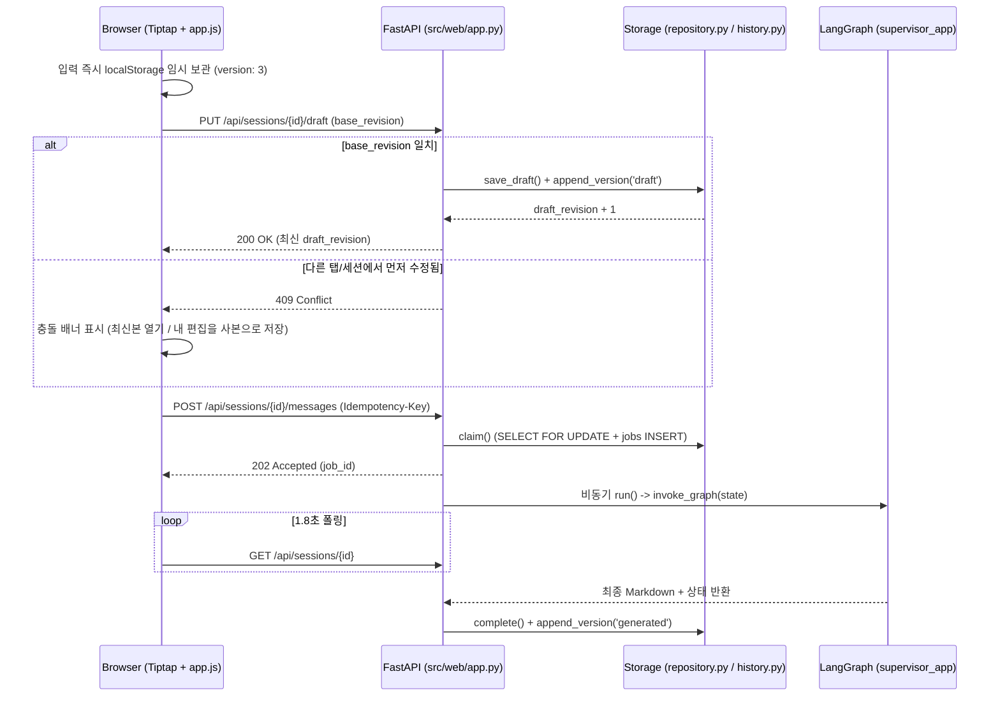

# 01. 웹 대시보드 · Tiptap 에디터 계층 (`src/web/`)

상위 허브: [[00-Index]] | 연관 계층: [[02-Storage-and-Auth]], [[03-LangGraph-Agents]], [[04-Models-and-Config]]
운영 가이드: [[dashboard]]

## 코드 모듈 노드 (클릭 시 함수/소스 확인)

- [[mod__web__app]] (`src/web/app.py`) — FastAPI 앱, `lifespan` 초기화, 인증/CSRF 미들웨어, 세션·초안·메시지·문장 다듬기 API
- [[mod__web__auth]] (`src/web/auth.py`) — `/api/auth/*` 라우터 (비밀번호 로그인, Google OIDC, 로그아웃, 현재 사용자 확인)
- [[mod__web__history_api]] (`src/web/history_api.py`) — `/api/sessions/{id}/versions`, `/restore`, `/jobs`, `/api/jobs/{id}` 라우터
- [[mod__main]] (`src/main.py`) & [[mod__front__ui_components]] (`src/front/ui_components.py`) — 레거시 Streamlit 인터페이스

## 초안 자동 저장 · 충돌 복구 · AI 요청 흐름

