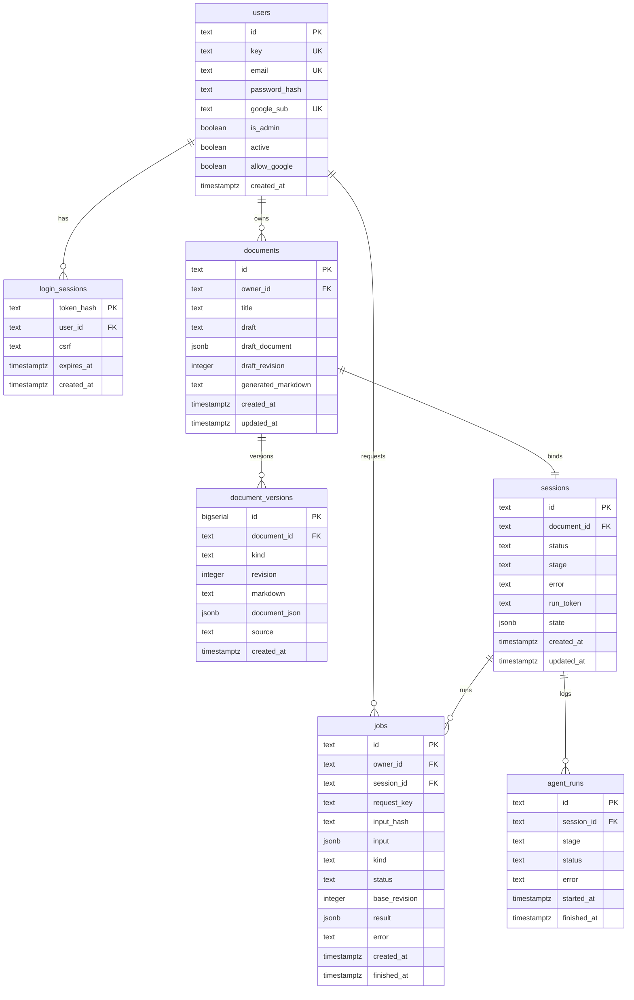

# 02. PostgreSQL 영속화 · 인증 · Job 계층 (`src/storage/`)

상위 허브: [[00-Index]] | 세부 캔버스: [[storage-auth-flow.canvas]]
연관 문서: [[postgresql-local]], [[postgresql-accounts-jobs]], [[postgresql-storage-design]], [[01-Web-and-Editor]]

## PostgreSQL 7개 테이블 노드 (Graph View 연동)

- [[db__users]] (`users`) — 계정, Argon2 해시, Google `sub`, 관리자 권한
- [[db__login_sessions]] (`login_sessions`) — 세션 쿠키 SHA-256 해시, CSRF 토큰, 만료 시각
- [[db__documents]] (`documents`) — 초안 Markdown, Tiptap JSONB, `draft_revision` 낙관적 잠금, 최신 AI 기획서
- [[db__document_versions]] (`document_versions`) — 모든 저장·생성·복원 스냅샷 이력
- [[db__sessions]] (`sessions`) — LangGraph `GlobalState` JSONB 스냅샷 및 진행 단계
- [[db__jobs]] (`jobs`) — `Idempotency-Key` 기반 중복 방지 및 비동기 작업 결과
- [[db__agent_runs]] (`agent_runs`) — 에이전트 실행 단계별 감사 로그

## 저장소 & 마이그레이션 코드 모듈 노드

- [[mod__storage__database]] (`src/storage/database.py`)
- [[mod__storage__repository]] (`src/storage/repository.py`)
- [[mod__storage__history]] (`src/storage/history.py`)
- [[mod__storage__accounts]] (`src/storage/accounts.py`)
- [[mod__storage__import_drafts]] (`src/storage/import_drafts.py`)
- [[mod__migrations__env]] (`migrations/env.py`)
- [[mod__migrations__versions__001_storage]] (`migrations/versions/001_storage.py`)
- [[mod__migrations__versions__002_history_auth]] (`migrations/versions/002_history_auth.py`)

## PostgreSQL 데이터베이스 ERD

