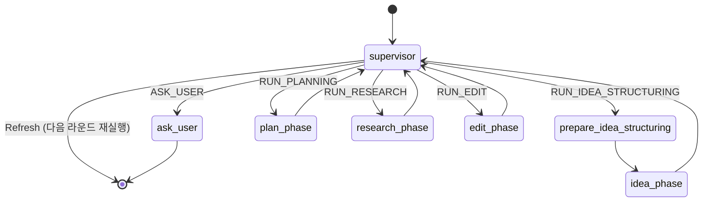

# 03. LangGraph 멀티 에이전트 파이프라인 (`src/graph/` & `src/agents/`)

상위 허브: [[00-Index]] | 세부 캔버스: [[langgraph-flow.canvas]]
연관 노트: [[01-Web-and-Editor]], [[04-Models-and-Config]], [[evaluation_agent]]

## 에이전트별 그래프 · 로직 · 상태 · 프롬프트 모듈 노드

| 에이전트 | 그래프 (`src/graph/`) | 에이전트 로직 (`src/agents/`) | 상태 (`src/state/`) | 프롬프트 (`src/prompts/`) |
|---|---|---|---|---|
| **Supervisor** | [[mod__graph__supervisor_graph]] | [[mod__agents__supervisor]] | [[mod__state__base]] | [[mod__prompts__supervisor_prompt]] |
| **Idea** | [[mod__graph__idea_graph]] | [[mod__agents__idea]] | [[mod__state__idea]] | [[mod__prompts__idea_prompts]] |
| **Plan** | [[mod__graph__plan_graph]] | [[mod__agents__plan]], [[mod__agents__plan_core__pipeline]], [[mod__agents__plan_core__nodes]], [[mod__agents__plan_core__generator]], [[mod__agents__plan_core__evaluator]], [[mod__agents__plan_core__schemas]], [[mod__agents__plan_core__logger]] | [[mod__state__plan]] | [[mod__prompts__plan_prompts]] |
| **Research** | [[mod__graph__research_graph]] | [[mod__agents__research]] | [[mod__state__research]] | [[mod__prompts__research_prompts]] |
| **Visual** | [[mod__graph__visual_graph]] | [[mod__agents__visual]], [[mod__agents__visual_core__router]], [[mod__agents__visual_core__nodes]], [[mod__agents__visual_core__generator]], [[mod__agents__visual_core__validator]], [[mod__agents__visual_core__schemas]] | [[mod__state__visual]] | [[mod__prompts__visual_prompts]] |
| **Edit** | [[mod__graph__edit_graph]] | [[mod__agents__edit]], [[mod__agents__edit_core__nodes]], [[mod__agents__edit_core__evaluation]] | [[mod__state__edit]] | [[mod__prompts__edit_prompts]] |
| **Evaluation** | [[mod__graph__evaluation_graph]] | [[mod__evaluate]], [[mod__agents__evaluation]], [[mod__agents__evaluation_core__metrics]], [[mod__agents__evaluation_core__schemas]] | [[mod__agents__evaluation_core__schemas]] | [[mod__prompts__evaluation_prompts]] |

## Supervisor 상태 전이 다이어그램

