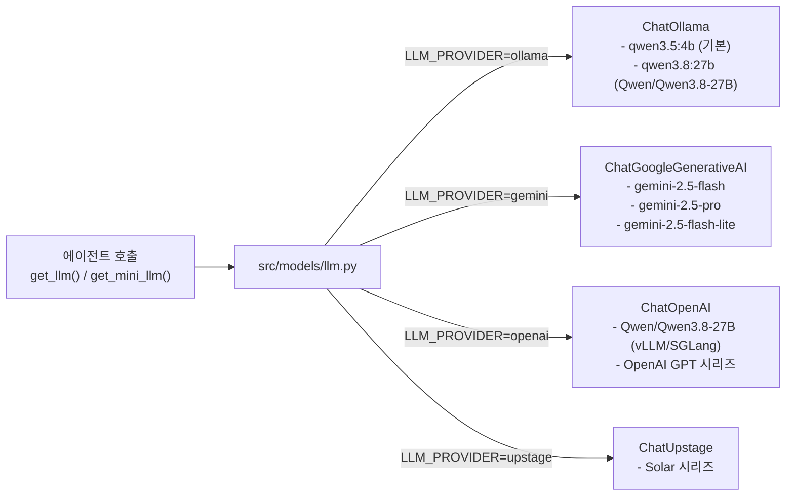

# 04. 공통 모델 팩토리 · 설정 계층 (`src/models/` & `src/config/`)

상위 허브: [[00-Index]] | 연관 노트: [[03-LangGraph-Agents]], [[ollama-docker]], [[dashboard]]

## 코드 모듈 노드

- [[mod__config__config]] (`src/config/config.py`) — 환경변수 및 모델 프리셋(`OLLAMA_MODEL_PRESETS`, `HF_MODEL_PRESETS`, `GEMINI_MODEL_PRESETS`)
- [[mod__models__llm]] (`src/models/llm.py`) — `get_llm()`, `get_mini_llm()` 공통 모델 팩토리
- [[mod__models__embeddings]] (`src/models/embeddings.py`) — FastEmbed CPU 임베딩 팩토리

## 지원 LLM 제공자 및 프리셋 (`src/models/llm.py`)

